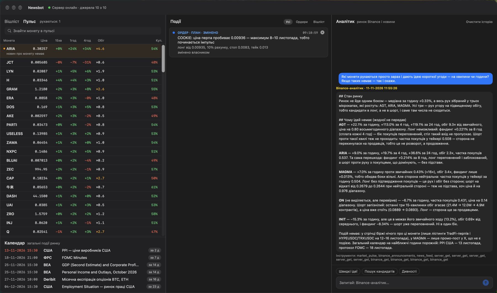
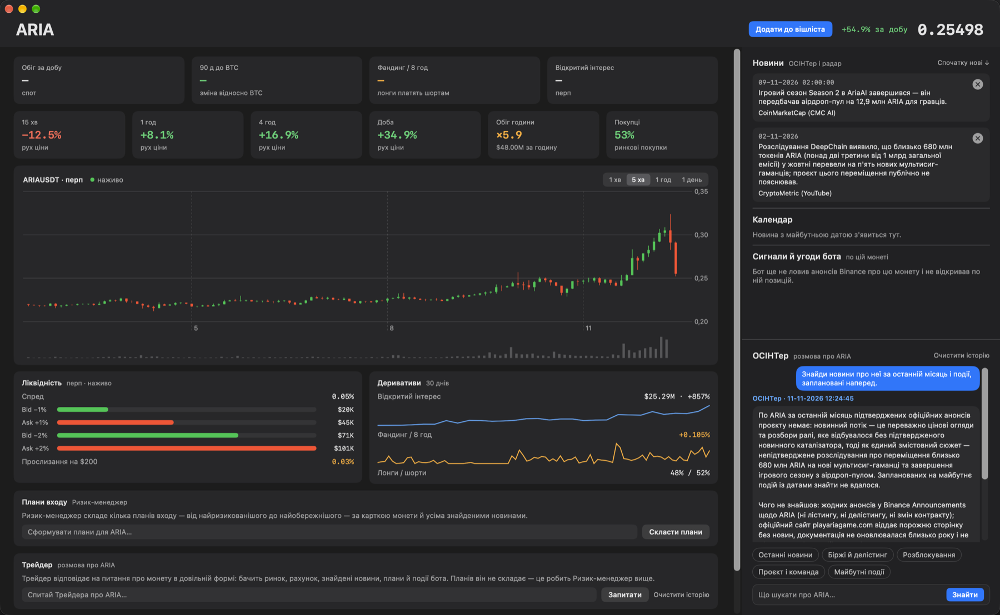

# newsbot

[](https://github.com/GrefferM/newsbot/actions/workflows/ci.yml) [](LICENSE)

A Go server that hears Binance announcements and watches DefiLlama incidents and sends a Telegram message
the moment one of them lands — only the kinds of event after which the price has measurably moved.
Each message says what happened, how important it is and the facts around it; the bot compares
nothing and forecasts nothing. Messages are written in Ukrainian.

Around the monitor stands a small trading desk for its owner: a scan of every coin with a perpetual,
agents that read the market and the news, and a macOS app. Its one aim is to understand where a coin
is moving and why — in either direction — and to say so plainly when no move is clear.





The app's interface is in Ukrainian. The account in the pictures holds test money.

## What it sends

| Event | Source | Mark | Measured effect (median, over BTC) |
|---|---|---|---|
| Full delisting, Vote to Delist | Binance announcements | 🚨 critical | −18.5% in 4 h |
| Monitoring Tag | Binance announcements | 🚨 critical | −9.0% in 4 h, most of it in the first minute |
| Perpetual contract delisting | Binance announcements | ⚠️ important | −9.2% in 4 h |
| «Binance Will Add X on Earn … & Margin» | Binance announcements | ⚠️ important | −6.6% in 4 h from the second minute |
| Hack of $5M or more (🚨 from $50M) | DefiLlama | ⚠️ / 🚨 | −5.3% on the day for a token with a perpetual |
| Stablecoin with $300M+ supply off $1 by 1% or more (🚨 from 3%) | DefiLlama | ⚠️ / 🚨 | rare, not measured |

The effects were measured on Binance one-minute candles from March 2025 to October 2026, each against
the same coin at the same time of day before the event.

Besides these, the desk tells about itself:

- every entry, exit and failure of a position;
- what became of an entry plan set to be watched — fired or refuted, with what woke the check, the
  price at that moment and the judge's reason, or lapsed; setting a plan to be watched tells nothing;
- an event with an exact date found in a coin's news and a token unlock: an
  all-day one on its day, a timed one ten minutes ahead and when it starts (Kyiv time; an approximate date gets no reminder);
- the market's general events — Fed meetings, the main US statistics, option expiries — ten minutes ahead
  and when they start. These are information, not triggers with a measured effect.

A short trigger also carries the Binance perpetual's facts at that moment — price, 24 h change,
volume, funding and the open-interest change over the last hour — and a 24 h chart of the coin with
the moment of the event marked.

## What it does

- Binance announcements arrive over the official announcements WebSocket, pushed the moment one is
  published. It needs a read-only API key: without the key the bot hears no announcements, and one
  published while the connection is being restored is not heard either.
- An announcement older than ten minutes is not sent: what matters is the first minutes, so after a
  restart nothing that has already played out arrives late.
- A source's first poll is silent — it remembers what is already there and sends none of it.
- A depeg is reported once, when a coin leaves $1, and not again until it comes back; a coin already
  down by half is ignored as dead.
- Every event the bot sees for the first time, sent or not, and every error of a source or of
  Telegram goes to a JSONL journal with the moment the bot saw it and the moment it was published —
  the raw material for measuring delays and the market's reaction.
- A scan of every crypto perpetual on Binance Futures runs every six hours, from the perpetual's daily
  candles: price, the day's and the week's move, the day's and the 30-day average volume, the 90-day
  move against BTC (where the contract is old enough), the takers' sell share, funding, open interest
  and the depth of the book. For a coin that also trades on spot the scan adds the Monitoring Tag and
  the spot volume, and marks a coin that carries the tag or trades under $0.3M a day on spot — the two
  signs that, on history, came before a delisting (about 60% and 20% of such coins were delisted
  within 120 days, against 3.7% of all coins). The watchlist is the owner's: coins are added and removed by
  hand, and the scan only supplies their market data.
- Trading is on the Binance Futures testnet with test money — the code knows no address
  of the real exchange; the account, a plan's size and a trade's result are the exchange's own, fees and funding included, and `ACCOUNT_CAPITAL` scales the desk to the account you mean to trade for real — and a position opens only from an entry plan set to be watched, after an agent
  confirms its condition. The owner sets a plan to be watched himself: the bot reminds of a calendar
  event ten minutes ahead, the owner asks the risk manager for plans, picks one,
  and at the event an agent either confirms the entry or the plan is dropped. With auto trading
  switched on, the desk does the same before a timed event of a coin and arms the most cautious plan;
  a contract the pulse marks is only shown. The plan names the side,
  the size, the stop and the target; the entry still passes the checks — the perpetual trades, the
  exposure stays within 100%, funding shows no crowded side (beyond 0.05% per 8 h) and the contract
  traded at least $1M in 24 h — and none is made for the rest of the day after losing 10% of the
  account. Positions are checked every minute against the futures price and closed at the stop, the
  target or after 24 hours. On the testnet the entry is a market order at leverage 1, the stop and
  the target are conditional orders on the exchange (the Algo Order API), and a position the exchange
  closed is read back from it. Every entry, exit and failure goes to Telegram and the journal; the
  account survives a restart.
- The HTTP API: `GET /healthz` shows each source's state; `GET /events` the latest events sent
  (`DELETE /events?id=` removes one from the feed); `GET /coins` every scanned coin, with the perpetual's live price; `GET /watchlist`
  the owner's watchlist with market data (`POST /watchlist` adds a coin, `DELETE /watchlist/{asset}`
  removes it); `GET /positions` the account and its positions (`POST /positions/{id}/close` closes one
  at once); `GET /coins/{asset}/news` the news the researcher found about a coin (`DELETE /news/{id}`
  removes one); `GET /coins/{asset}/plan` the risk manager's entry plans for a coin, kept as they are
  made (`PUT` stores them); `GET /watches` every plan still being watched; `GET /auto` the auto-trading switch (`PUT` turns it), `GET /results` what became of the watched plans and the trades; `GET /coins/{asset}/watches` the plans of one coin set to be watched (`POST` arms one,
  `PUT /watches/{id}` changes its numbers but not its condition, `DELETE /watches/{id}` takes it off);
  `GET /pulse` the market's live pulse with the contracts that woke up, `GET /tradfi` the same for commodities and the most
  liquid US equities; `GET /calendar` the market's general events
  of the past week and ahead together with the exact dates found in the coins' news and the coming token unlocks; `POST /agents/{name}` asks an agent about a topic, `GET /agents/{name}/history` its last
  exchanges (`DELETE` makes it forget them); `POST /scout` searches for candidates; `POST /ideas` reads
  the pulse for ideas of short trades.

**Built with** the Go standard library alone — including the WebSocket client and the PNG chart with
its own pixel font.

## What was tried and left out

Each was measured the same way and dropped for having no move a reader could act on: price-move
alerts by a coin's own norm (half of them gave the move back within 4 h), extreme funding (the short
pays more in funding than the price falls), Binance spot listings and new perpetuals (the move is over
before a message arrives), Coinbase, Hyperliquid, Bithumb and Upbit listings, the token-unlock digests posted on X (they named an unlock a day or two before the coin's own schedule), US macro releases as
a trigger of a message (the calendar only reminds of them), hacks under $5M, news Telegram channels and media feeds, and an LLM grading events instead
of the rules (it called 93% of them significant and read their direction worse).

## How it is laid out

A plain Go layout: `cmd` for the program, `internal` for one package per feature or outside service.

- `cmd/newsbot` — configuration, the sources, the agents' wiring, the builders of each feature and the
  start of everything.
- The bot's features: `monitor` (collecting events, dropping what was seen, adding the market facts,
  drawing the chart, publishing, the health of the sources and the run of it all), `watchlist` (the
  scan of every coin and the owner's list), `trading` (the strategy, its checks, the account and the
  trader, on the testnet), `research` (the news found about each coin, their dates as calendar entries, and the risk manager's
  entry plans), `radar` (the market's live pulse of coins and of TradFi commodities and US equities: what launched from quiet —
  an hourly candle several times the usual after two flat days —, what woke up —
  open interest and the share of long accounts shifted sharply together — and what holds
  a steady trend for days; a mark is only shown), `autopilot` (the plans set to be watched, asked about once when their price, their
  date or a new event comes), `agenda` (the calendar of the market's events, unlocks and the coins' dates, and its reminders), `autotrade`
  (the auto-trading switch: before a coin's timed event the most cautious plan is armed), `agents`
  (asking a model and running its tools; every agent reads the desk's shared journal of what became of the
  past plans and trades), with `agents/tools` and `agents/prompts`.
- Shared vocabulary: `news` (the event and its formatting), `exchange` (which Binance titles matter
  and when an announcement is too old), `market`, `incident` (hacks and depegs), `schedule` (a dated
  entry of the calendar).
- Clients of outside services: `binance` (announcements, futures and the scan built on them, spot for the tag, the testnet), `defillama`,
  `fed`, `bea`, `fred`, `finnhub` and `deribit` (the dates of the market's calendar; `fred` and `finnhub` need a free key),
  `unlocks` (the coming token unlocks of a table a script of the owner's prints),
  `coingecko` (a project's official links), `googlenews` (free headlines), `tavily` (web search), `xapi` (posts on X) and `web` (a page
  as text) — all five the researcher's alone: no other agent reaches outside Binance and the bot's own data —, `llm` (the model API), `telegram`, `console` (dry run), `chart`, `websocket`,
  `httpclient`.
- `filestore` (seen-state, journals, the desk's positions, the watchlist, the last scan and the
  research), `dotenv`, and `httpapi`, the HTTP API above.
- `deploy/newsbot.service` — a systemd unit.
- `mac` — the macOS app: a window with the watchlist, the coins and TradFi pulses, the calendar of the market's events and the
  coins' dates, the events, the auto-trading switch and a chat with
  a market analyst who screens the coins and checks what is said about them, a search over every
  token to add to the watchlist, a coin page with a live candle chart, the order book and the
  derivatives, the news an OSINT researcher finds, kept with the coin, and a chat with it, the risk manager's entry
  plans, a chat with a trader about the coin, the plans that wait to become orders, and what the bot saw about the coin, a
  position window, and a menu-bar item with the latest
  events and the account. It reads the
  server's HTTP API. `mac/design` holds its design: the frames in `canvas/`, what each one decides in
  `Карта кадрів.md`.
- `docs` — the pictures of the app shown above.
- `.github/workflows/ci.yml` — CI: `gofmt`, `go vet` and `go test -race` on every push to `main` and
  every pull request.
- `CLAUDE.md` — how work is done in this repository: architecture, code style, checks, documentation
  and commits.

## Running it

Go 1.26.

```bash
cp .env.example .env && chmod 600 .env   # the Telegram bot token and chat, a read-only Binance key
go test ./...
go run ./cmd/newsbot -once 3             # one pass over the sources, up to 3 events each, printed
DRY_RUN=1 go run ./cmd/newsbot           # the full run, messages printed instead of sent
go run ./cmd/newsbot -check-testnet ETHUSDT   # one testnet cycle: a $50 short, its stop and target, closed; its fees show in the desk's equity
go run ./cmd/newsbot                     # the full run, sending to Telegram
```

Every setting is listed in `.env.example`; a variable already in the environment wins over the file,
and `-env <path>` reads another one. State and the journal go to `data/`.

On a server it runs as the `deploy/newsbot.service` unit from `/opt/newsbot`, holding the binary,
`.env` and `data/`. Binance refuses US addresses, so the server must stand elsewhere. Before a new
binary replaces the old one, run it with `DRY_RUN=1` against a copy of the server's `data/`, with
`NEWSBOT_DISABLE=pulse,watchlist` so it does not read the whole market beside the live server:
nothing already sent may come out again.

## The macOS app

macOS 14 or later. A ready build is `dist/Newsbot-1.0.0.dmg`: drag Newsbot to Applications. It is signed
only locally, without an Apple developer account, so the first time macOS asks to confirm it: open it
from Applications with Control-click → Open, or allow it in System Settings → Privacy & Security.

To build it yourself you need Xcode: open `mac/Newsbot.xcodeproj` and run the `Newsbot` scheme, or from the
terminal:

```bash
mac/scripts/build.sh                     # builds mac/.build/Newsbot.app, stripped of debug symbols
open mac/.build/Newsbot.app
```

The server's API stays on its loopback. In the app's Settings name the server (`user@host`) and the SSH
key: the app opens an SSH tunnel to it when it starts and closes it when it quits, and reaches the API at
`http://127.0.0.1:8080`. Without a server named there the app talks to the address as it is. The agents run on the server: it needs a key of an
OpenAI-compatible model API in `.env` (`MODEL_KEY`, with `MODEL_URL` and `MODEL_NAME`; any provider with an OpenAI-compatible
`/chat/completions` and tool calls will do). With a
Tavily API key (`TAVILY_KEY`) the researcher also searches the web, with an X API bearer token
(`X_BEARER_TOKEN`) it reads public posts on X, with a script of your own that prints a CSV table of coming unlocks (`NEWSBOT_UNLOCKS_SCRIPT`) the calendar gains the token unlocks, once a day, with a free FRED key (`FRED_KEY`) the calendar gains
the days of CPI, PPI and the jobs report, and with a free Finnhub key (`FINNHUB_KEY`) the earnings dates of
the US equities on the TradFi tab. Each
agent reaches the market or the bot's own data only through its tools, the web is the researcher's alone, and an order
is placed only from a plan with a price threshold set to be watched — by the owner or, with auto trading on, by the desk — after the judge confirms its condition.

## Licence

Copyright © 2026 [Mykhailo Biloshkurskyi](https://www.linkedin.com/in/mykhailo-biloshkurskyi/).
Licensed under the [Apache License, Version 2.0](https://www.apache.org/licenses/LICENSE-2.0) — see
`LICENSE` and `NOTICE`.
